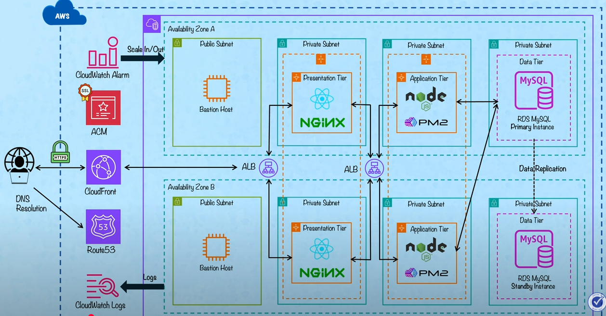

# AWS 3-Tier Full-Stack Architecture

<div align="center">


**A production-style, highly available 3-tier AWS deployment for a React, Node.js, and MySQL application.**

[Architecture](#-architecture) • [AWS Services](#-aws-services-used) • [Repository Files](#-repository-files) • [Deployment Guide](#-deployment-guide) • [Security](#-security-best-practices) • [Author](#-author)

</div>

---

## 📖 Overview

This project demonstrates how to deploy a full-stack application across isolated AWS tiers while improving availability, scalability, security, and maintainability.

The solution separates the presentation, application, and database layers, uses load balancing and Auto Scaling across multiple Availability Zones, and provides separate CI/CD pipelines for frontend and backend deployments.

> [!NOTE]
> This repository contains infrastructure diagrams, bootstrap scripts, and deployment notes. The React source code, Node.js application source, database dump, `buildspec.yml`, and `appspec.yml` files are maintained separately.

---

## 🏗 Architecture


### Traffic Flow

```text
Internet
   │
   ▼
Internet-facing Application Load Balancer
   │
   ▼
Web Tier — Nginx on EC2 instances
   │
   ▼
Internal Application Load Balancer
   │
   ▼
Application Tier — Node.js / Express on EC2 instances
   │
   ▼
Amazon RDS for MySQL
```

### Three-Tier Design

| Tier | Purpose | Resources |
|:---|:---|:---|
| **Presentation** | Serves the React application and proxies API requests | Public subnets, external ALB, Nginx, EC2 Auto Scaling Group |
| **Application** | Runs the Node.js API and application logic | Private subnets, internal ALB, Node.js, PM2, EC2 Auto Scaling Group |
| **Data** | Stores application data securely | Private subnets, Amazon RDS for MySQL |

The presentation and application tiers run in separate private/public security boundaries across multiple Availability Zones. Database access is restricted to approved application-tier resources.

---

## 🔄 Architecture Flow



The CI/CD flow delivers frontend and backend artifacts independently:

1. Developer pushes source code to GitHub.
2. AWS CodePipeline detects the change.
3. AWS CodeBuild builds the application and creates an artifact.
4. AWS CodeDeploy deploys the artifact to the appropriate EC2 Auto Scaling Group.
5. Elastic Load Balancing routes traffic through healthy instances.
6. CloudWatch collects application and infrastructure logs.

---

## ☁️ AWS Services Used

| Category | AWS Services |
|:---|:---|
| Compute | Amazon EC2, EC2 Launch Templates, EC2 Auto Scaling |
| Networking | Amazon VPC, Public and Private Subnets, Internet Gateway, NAT Gateway |
| Load Balancing | Internet-facing and Internal Application Load Balancers |
| Database | Amazon RDS for MySQL |
| CI/CD | AWS CodeCommit/CodePipeline-ready GitHub integration, AWS CodeBuild, AWS CodeDeploy |
| Security | IAM Roles, Security Groups, Systems Manager Parameter Store |
| Storage | Amazon S3 |
| Monitoring | Amazon CloudWatch Logs and CloudWatch metrics |
| Delivery | Optional Amazon CloudFront and Amazon Route 53 |

---

## 📁 Repository Files

| File | Description |
|:---|:---|
| [Architecture.png](./Architecture.png) | Main AWS 3-tier architecture diagram |
| [Architecture-flow.png](./Architecture-flow.png) | Architecture and deployment flow diagram |
| [Documentation.txt](./Documentation.txt) | Complete AWS infrastructure, security, and CI/CD implementation guide |
| [AWS CICD Pipeline - AWS.txt](./AWS%20CICD%20Pipeline%20-%20AWS.txt) | Original infrastructure and CI/CD deployment notes |
| [app-tier-user-data.txt](./app-tier-user-data.txt) | Amazon Linux bootstrap script for Node.js, PM2, CloudWatch, and CodeDeploy |
| [web-tier-user-data.txt](./web-tier-user-data.txt) | Amazon Linux bootstrap script for Nginx, CloudWatch, and CodeDeploy |

---

## 🚀 Deployment Guide

The detailed step-by-step checklist is available in [Documentation.txt](./Documentation.txt).

### 1. Prerequisites

- AWS account with permissions for VPC, EC2, RDS, IAM, ELB, S3, CodeBuild, CodeDeploy, CodePipeline, and CloudWatch
- AWS CLI or AWS Management Console access
- EC2 key pair, where required
- GitHub repository containing the application source
- Domain name and TLS certificate for HTTPS
- Familiarity with Linux, networking, React, Node.js, and MySQL

### 2. Infrastructure Setup

1. Create a VPC with public and private subnets across two Availability Zones.
2. Configure Internet Gateway, NAT Gateway, and route tables.
3. Create tier-specific security groups.
4. Create IAM roles for EC2, CodeBuild, CodeDeploy, and CodePipeline.
5. Create private RDS MySQL subnet groups and database instance.
6. Store database host, port, name, username, and password in Systems Manager Parameter Store.

### 3. Application Tier

1. Create an application-tier launch template.
2. Bootstrap EC2 instances with [app-tier-user-data.txt](./app-tier-user-data.txt).
3. Create an internal Application Load Balancer and target group.
4. Configure the application-tier Auto Scaling Group.
5. Deploy the Node.js application on port `3200`.

### 4. Presentation Tier

1. Create a web-tier launch template.
2. Configure Nginx and the internal ALB endpoint using [web-tier-user-data.txt](./web-tier-user-data.txt).
3. Create an internet-facing Application Load Balancer and target group.
4. Configure the web-tier Auto Scaling Group.
5. Deploy the React build into Nginx.

### 5. CI/CD Pipelines

Create separate pipelines for the presentation and application tiers:

| Stage | Application Tier | Presentation Tier |
|:---|:---|:---|
| Source | GitHub repository | GitHub repository |
| Build | `backend/buildspec.yml` | `frontend/buildspec.yml` |
| Deploy | `backend/appspec.yml` | `frontend/appspec.yml` |
| Target | Application ASG / internal ALB target group | Web ASG / external ALB target group |

After deployment, attach HTTPS, configure Route 53, and optionally add CloudFront for global delivery.

---

## 🛡 Security Best Practices

- Never commit database credentials or AWS secrets to Git.
- Store sensitive values as `SecureString` parameters in AWS Systems Manager Parameter Store or AWS Secrets Manager.
- Use least-privilege IAM policies instead of broad administrative access.
- Keep RDS and application servers in private subnets.
- Restrict security groups by source security group, not `0.0.0.0/0`.
- Use AWS Systems Manager Session Manager instead of exposing SSH where possible.
- Enable encryption for EBS, RDS, S3, and backup data.
- Use HTTPS at the load balancer and restrict HTTP to redirects.
- Enable database backups, deletion protection, and Multi-AZ for production workloads.
- Review CloudWatch logs and set alarms for unhealthy instances and application errors.

> [!WARNING]
> Review every bootstrap script before deployment. Replace sample domains, endpoints, regions, resource names, credentials, and account-specific values.

---

## ✅ Validation Checklist

- [ ] VPC DNS hostnames and required route-table routes are enabled.
- [ ] Public and private subnets are associated with the correct route tables.
- [ ] Security groups allow only required tier-to-tier traffic.
- [ ] RDS endpoint is reachable only from the application tier.
- [ ] Application health checks return a successful response.
- [ ] Internal ALB forwards API traffic to healthy application instances.
- [ ] External ALB forwards requests to healthy Nginx instances.
- [ ] CloudWatch receives application and deployment logs.
- [ ] CodeBuild, CodeDeploy, and CodePipeline roles have only required permissions.
- [ ] HTTPS, DNS, and CloudFront are configured before production use.

---

## 🎯 Learning Objectives

- Design an isolated and highly available AWS network.
- Deploy private EC2 application and database tiers.
- Configure external and internal Application Load Balancers.
- Implement EC2 Auto Scaling for horizontal scaling.
- Set up separate frontend and backend CI/CD pipelines.
- Apply AWS security, secret-management, logging, and monitoring practices.

---

## 🤝 Contributing

Contributions that improve the diagrams, deployment documentation, automation, or security guidance are welcome.

Before submitting changes:

1. Remove account IDs, credentials, certificates, domains, and environment-specific values.
2. Keep documentation aligned with the scripts and architecture diagrams.
3. Test infrastructure changes in a non-production AWS account.

---

## 👨‍💻 Author

**Kunal Jadhav**

- 🌐 **Portfolio:** [kunalcloud.shop](https://kunalcloud.shop/)
- 🐙 **GitHub:** [@devkunaljadhav](https://github.com/devkunaljadhav)
- 💼 **LinkedIn:** [Kunal Jadhav](https://www.linkedin.com/in/devkunaljadhav)
- 📧 **Email:** [kunaljadhav1625@gmail.com](mailto:kunaljadhav1625@gmail.com)

---

<div align="center">

**If this project helped you, consider giving the repository a ⭐**

</div>
